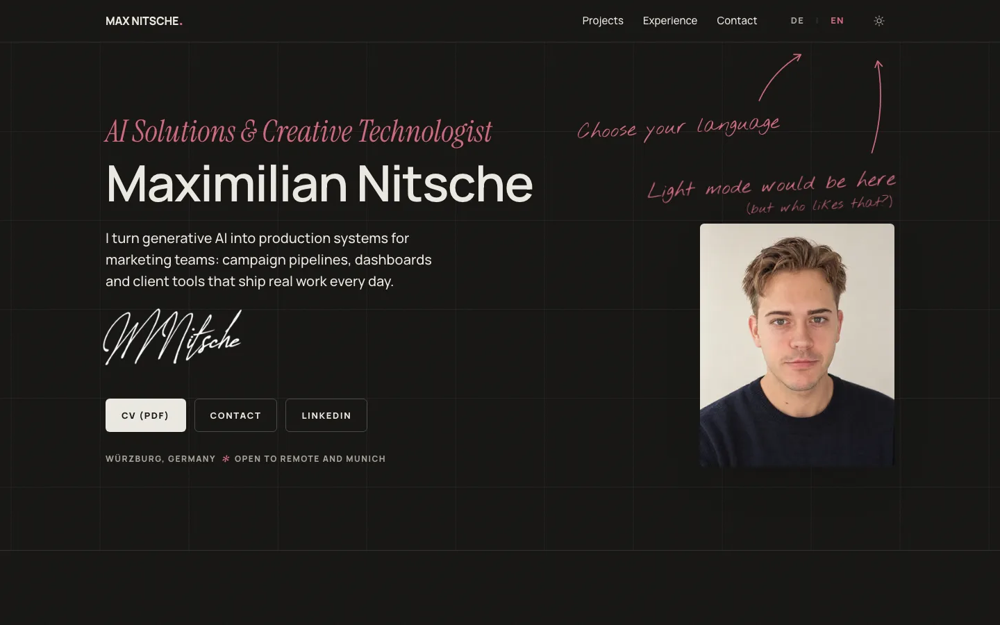
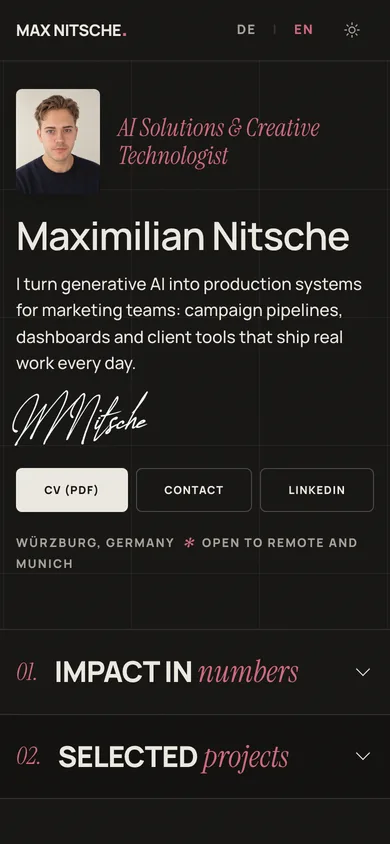

# Interactive CV · [elevion.studio/max](https://elevion.studio/max)

My CV as a small static site plus ATS-friendly PDFs, all generated from one JSON source per language. Built with [Claude Code](https://claude.com/claude-code).

<p>
  
  
</p>

## What it does

- **One source, many outputs.** `content/de.json` and `content/en.json` drive the bilingual website, two PDFs and role-specific PDF variants (`profile_variants`).
- **No framework.** A single ES module renderer (`src/render.js`) prerenders the page in Node and re-renders it in the browser when you switch language. No layout shift, no hydration.
- **ATS-safe PDFs.** Rendered with headless Chromium (Playwright): real text, single column, document metadata set, checked for page count and reading order.
- **Details.** Dark mode by default, light mode easter egg, handwritten first-visit hints, project dialogs with demo videos and auto-scrolling ad reels, collapsible sections on mobile, `prefers-reduced-motion` respected throughout.
- **Media pipeline.** sharp for responsive AVIF/WebP/JPG, ffmpeg for web-ready H.264 demo clips.
- **Privacy.** The phone number only ever goes into the PDFs; it is stripped from the website data and kept out of this repo.

## Commands

```bash
npm install
npm run build                                  # content -> dist/max (website)
npm run pdf                                    # website + PDFs into dist/max/cv + OG image
npm run pdf -- --variant=solutions_engineer    # tailored profile, PDFs in out/variants
npm run check                                  # page count, text extraction, dash scan, TODO list, WCAG contrast
npm run serve                                  # http://localhost:4321/max/
```

`npm run build` also writes `Max-CV-lokal.html`, a copy that opens straight from disk (file://) without a server.

## Project layout

```
content/      de.json, en.json (+ private.json, not in git: phone number)
src/          render.js (shared renderer), site.js (browser behaviour), styles.css
scripts/      build.mjs, pdf.mjs, check.mjs, serve.mjs
media/        portrait, signature, project screenshots and videos (not in git: client material)
```

Without `media/` the site still builds; images fall back to labelled placeholders.

## Deployment

`dist/` is the publish directory. Every path is absolute under `/max/`, so it runs as its own Netlify project behind a proxy rewrite on the main domain:

```
/max     https://<cv-project>.netlify.app/max/index.html  200
/max/*   https://<cv-project>.netlify.app/max/:splat     200
```

## License

Code: MIT. CV text, photos and project media: all rights reserved.
